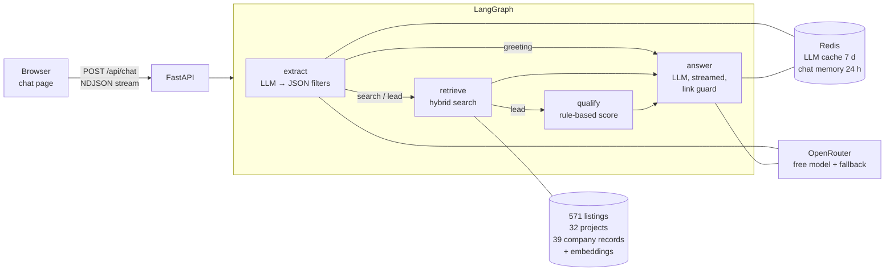

# DarGlobal & Wasalt Property Assistant

A bilingual (English / Arabic) property chatbot over public data scraped from **DarGlobal** (32 luxury branded projects in 6 countries, plus the company's FAQ, visa, office and partner pages) and **Wasalt** (571 Saudi listings for sale and rent). Built with LangGraph, hybrid search, a free OpenRouter model, Redis and Docker.

**Live demo:** _AWS link goes here_

## What it does

- **Answers from real data only.** Every property comes with its link; a guard removes any link the search did not return, so the bot can't send users to invented pages.
- **Knows the company, not just the listings.** "Who runs DarGlobal?", "Can I get a golden visa if I buy in Dubai?", "What documents do I need?" and "Where is your London office?" are answered from DarGlobal's own FAQ, Why Invest, Investor and Contact pages.
- **Understands filters and meaning.** "3-bed apartment in Jeddah under 1M" is an exact filter; "seaside home with a private beach" or an Arabic question about English project pages is matched by meaning.
- **Speaks the buyer's currency.** "Under $200k" or "£2,000 a month" is converted to SAR for the search, and prices are shown in both (Gulf pegs exact, GBP/EUR/INR from the ECB).
- **Qualifies leads for the sales team.** When someone wants to buy or visit, the bot scores the lead (budget, location, timeline, purpose → hot / warm / cold), asks for the one missing detail, then hands off to the project's Register Interest form. It never collects names, phones or emails.
- **Feels fast.** Replies stream as they are written, the page shows what stage it is at ("Found 8 matches, writing the answer…"), results appear as cards, and repeated questions are answered from a Redis cache in about 0.1 s.
- **Remembers the conversation.** "Cheaper ones?" and "tell me more about the third one" work; chats live in Redis and expire after 24 hours idle. "New chat" starts over.
- **Reads Arabic properly.** Arabic questions get Arabic answers, laid out right to left.

## Architecture



**Why two model calls with search in between:** free models are unreliable at tool calling but reliable at small JSON. The first call turns the question into filters, plain code searches, and the second call answers only from what was found. The search is deterministic and testable, and the model can't invent listings.

**Hybrid search:** exact filters (city, purpose, type, bedrooms, price) narrow the listings; within them, a multilingual embedding model (`paraphrase-multilingual-MiniLM-L12-v2`, ONNX, about 4 ms per question) ranks by meaning, with a keyword bonus so exact names like "DG1" still win. Project pages are split into 296 chunks; company records are one vector each. No vector database: about 910 vectors fit in a NumPy array.

## Evaluation

`uv run python -m eval.run` (no model calls) · `uv run --env-file .env python -m eval.run --e2e` (real bot). 37 cases in English and Arabic: [eval/cases.json](eval/cases.json), full results in [eval/results.md](eval/results.md).

| Retrieval: expected project in the top 3 | Keyword search (before) | Hybrid search (now) |
| --- | --- | --- |
| English questions (17) | 17/17 | 17/17 |
| Arabic questions (4) | 0/4 | 4/4 |
| **All (21)** | **81%** | **100%** |
| Company questions: right page in the top 2 (6) | | 6/6 |

The end-to-end evaluation (source routing, filter-field accuracy, language match, attribution, invented links removed, latency p50/p95) is in the same script. Its results go here once run against the live model.

Unit tests: `uv run pytest` (31 tests, no API key needed): filters, city spellings, monthly vs yearly rent, relaxation, vector search incl. Arabic, company pages, link guard incl. links split across streamed pieces, lead scoring, currency conversion, the cache, key fallback, streaming API and the 503 path.

## Decisions

Every choice, with the reason and what it replaced or ruled out.

**Data**
- **Follow robots.txt and Wasalt's llms.txt.** Allowed paths only, about 1–2 requests per second, "Source: Wasalt.sa" on every answer that uses Wasalt, no commercial use.
- **Wasalt: sitemap + the page's embedded JSON, 600 sampled listings.** Clean structured fields without a headless browser; an even stride over about 60,000 URLs covers many cities and types. The full crawl would take hours and break the "moderate rate" rule.
- **No contact data stored.** Phone, WhatsApp and agent fields are dropped: llms.txt forbids collecting contacts at scale, and the bot doesn't need them.
- **DarGlobal: read as a normal visitor, never forced.** The site is behind bot protection; a stealth headless browser would be getting around an access control. Pages were read in a real browser tab at about 1 per second.
- **Company FAQ and pages as a third data set.** 31 FAQ answers and 21 pages (about, investor, visas, offices, hospitality, tokenization, brand partners), cleaned into 39 records. Used only for DarGlobal questions: their match scores overlap with listing questions, so adding them everywhere would cost tokens for nothing. Blog and press are skipped (news, not buyer questions).

**How the bot works**
- **Extract filters → search → answer, not an agent with tools.** Free models are weak at tool calling; this flow is testable and can't invent listings.
- **LangGraph for the flow.** Conditional steps (skip search for greetings, add lead scoring for buyers), streaming and per-chat memory come built in.
- **Hybrid search in memory, not Elasticsearch or a vector database.** About 600 records; filters need exact numbers, Arabic needs meaning. A NumPy array does both in milliseconds. At full scale: Postgres + pgvector or Elasticsearch.
- **Link guard.** Any URL in the answer that the search didn't return becomes "(link removed)", checked line by line while streaming.
- **Currency in code, not by the model.** Models get conversions wrong; Gulf currencies use their fixed pegs, GBP/EUR/INR use ECB rates loaded at startup. An unknown currency skips the price filter and says so, instead of being read as SAR.
- **Rule-based lead score, not another model call.** Instant, explainable, no extra rate-limit risk. Leads go to the project's Register Interest form; the bot never asks for contact details.
- **No supervisor / multi-agent setup.** Each extra routing step adds 3–5 s on free models, and the current questions don't need it.

**Models and cost**
- **Free models: Ernie 5.5 Flash, with Nemotron 3 Ultra as fallback.** Chosen by measured speed and reliability; the first choice (Gemma) kept hitting rate limits.
- **Several API keys, tried in order.** `OPENROUTER_API_KEY`, then `_1`, `_2`, …: each key tries both models, and the next key is used when OpenRouter refuses (daily limit, bad key). A timeout doesn't switch keys: the model would be just as slow on another key, and the wait would double.
- **Smallest token budget that still works.** Lowest reasoning level each model allows (read from OpenRouter at startup), trimmed history (last 6 messages, older replies cut to 300 characters), greetings skip the filter step. Prompt tokens for a 4-turn chat: 10.5K → 8.7K.
- **Chat history kept in the filter step.** Removing it saved more tokens but broke "tell me more about the third one".

**Serving**
- **FastAPI + one HTML page.** No build step; the page streams answers, shows a stage-aware status and result cards for the properties the answer mentions.
- **NDJSON stream.** One line with result cards, then text pieces, so cards and text arrive on the same connection.
- **Redis for the model cache (7 days) and chat memory (24 h).** Survives restarts and redeploys and expires on its own; without `REDIS_URL` it falls back to memory.
- **Redis in Docker Compose.** `redis:8` includes the modules LangGraph's Redis memory needs, which managed services like ElastiCache lack.
- **AWS: one EC2 instance running Docker Compose, Caddy for HTTPS.** The same stack as tested locally; App Runner is closed to new customers, and ECS + ElastiCache is more setup for the same result. Caddy gets the certificate on its own; without a domain, `<ip>.sslip.io` points at the server. API keys go into `.env` over SSH, never into user data.
- **uv for Python.** One lock file for local runs and the Docker image.
- **Page design.** Gulf blue, sea green for Wasalt and brass for DarGlobal; one font family covers English and Arabic; starter questions grouped by where the answer comes from.

## Run it

```sh
cp .env.example .env            # add your OpenRouter key (optionally more: OPENROUTER_API_KEY_1, _2, …)
docker compose up --build       # chatbot + Redis → http://localhost:7860
```

Without Docker: `uv sync`, `docker compose up -d redis` (or leave `REDIS_URL` empty for in-memory), then `uv run --env-file .env uvicorn app.main:app --port 8000`.

## Deploy on AWS

Files in [deploy/](deploy/). One EC2 instance; about USD 15 a month for a t3.small, less inside the free tier.

1. **Launch an instance** (EC2 console): Ubuntu 24.04, t3.small (2 GB), 8 GB disk is enough (the free tier allows up to 30). Security group: SSH (22) from your IP only, HTTP (80) and HTTPS (443) from anywhere. Under *Advanced details → User data*, paste [deploy/user-data.sh](deploy/user-data.sh) (installs Docker, adds swap, clones this repo).
2. **Give it a fixed address:** allocate an Elastic IP and associate it, so the URL doesn't change on a restart.
3. **Add keys and start**, over SSH or EC2 Instance Connect:
   ```sh
   cd darGlobal && cp .env.example .env && nano .env   # paste your OpenRouter key(s)
   sh deploy/up.sh                                      # prints https://<ip>.sslip.io
   ```
   With your own domain: point an A record at the Elastic IP, then `DOMAIN=chat.example.com sh deploy/up.sh`.
4. **Update later:** `sh deploy/up.sh` again (pulls and rebuilds).

## Data and scraping

Scrapers: [scraper/](scraper/). `wasalt.py` reads the public sitemap and each listing's embedded JSON; `clean_darglobal.py` cleans the project pages; `darglobal_company.js` collects the FAQ and company pages in a browser tab. Data snapshot: 19–20 Nov 2026, in [data/](data/).

## Limits and next steps

- Data is a snapshot: 571 of about 60,000 Wasalt listings; DarGlobal projects, FAQ and company pages, but not blog or press. Next: a scheduled refresh.
- Free models are rate-limited (a daily cap per account); the cache and fallback model soften this.
- Leads are logged, not sent anywhere; next is a CRM hand-off (DarGlobal uses Salesforce).
- Search thresholds were tuned by hand on a small set; the eval set should grow from real questions.

## How this was built

_Your own note goes here: time spent, and how you used AI tools (for example, an AI coding assistant for implementation, with you making and reviewing the decisions above). Reviewers value an honest note._
